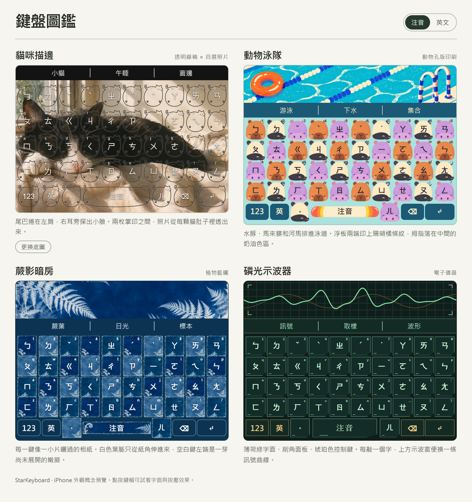
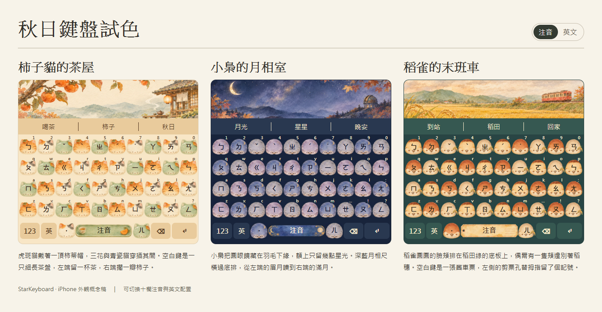

# StarKeyboard 主題設計圖鑑

七款 iPhone 鍵盤外觀概念稿。下載下列任一份 `preview.html`，用瀏覽器開啟即可切換十欄注音與英文。每份 HTML 都已內嵌圖像，可離線使用。鍵盤 App 的實際套用仍待原生整合。

## 線條、動物、自然與科技

[互動預覽檔](keyboard-collection/preview.html) · [美術提示詞](keyboard-collection/ART_PROMPTS.md)

| 主題 | 設計 | 素材與細節 |
| --- | --- | --- |
| 貓咪描邊 | 細線勾出貓耳、尾巴和掌印。鍵帽透明，同一張照片貫穿整片鍵盤，預覽中可更換底圖。 | [手機尺寸效果](keyboard-collection/cat-outline.png) · [範例底圖](keyboard-collection/cat-background.png) |
| 動物泳隊 | 水豚、馬來貘和河馬排成泳道，橘白浮板作為空白鍵。 | [孔版印刷風原畫](keyboard-collection/pool.png) |
| 蕨影暗房 | 每鍵像一枚藍曬標本，蕨葉從紙角伸入字面。 | [藍曬風原畫](keyboard-collection/fern.png) |
| 磷光示波器 | 薄荷綠字面搭配琥珀色功能鍵，點按時上方的訊號曲線跟著變化。 | 波形與鍵帽由預覽檔即時繪製。 |

## 秋日水彩

[互動預覽檔](autumn-keyboards/preview.html) · [美術提示詞](autumn-keyboards/ART_PROMPTS.md)

| 主題 | 設計 | 原畫 |
| --- | --- | --- |
| 柿子貓的茶屋 | 戴柿蒂帽的虎斑、三花與青瓷貓。寬鍵是一只盛著茶與柿子的茶盤。 | [茶屋素材](autumn-keyboards/persimmon.png) |
| 小梟的月相室 | 三隻小梟把眼圈藏在羽毛下緣，空白鍵兩端分別是眉月與滿月。 | [月相室素材](autumn-keyboards/observatory.png) |
| 稻雀的末班車 | 火車駛過稻田，稻雀守著每一鍵。剪角車票留下整片空白鍵的字面。 | [鐵道素材](autumn-keyboards/railway.png) |
